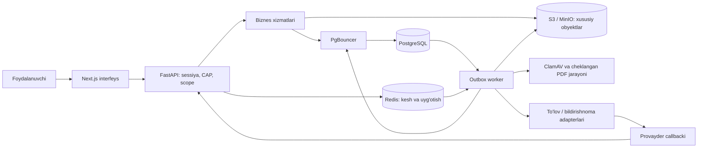

# TD-001 — FlexBridge tuzatishlarini bajarish bo'yicha texnik qo'llanma

Sana: 2026-11-07, Asia/Tashkent. Muallif: Codex. Asos: REV-001 va `8bb0ad2` dagi kod/sxema.

Bu hujjat bajarilishi kerak bo'lgan texnik ishni tushuntiradi. Undagi yangi modullar, migratsiyalar, holatlar va testlar hali amalga oshirilmagan. S2 holati `Tuzatish kerak` bo'lib qoladi. R1 — ish va amaliyot; R2 frilans funksiyalari hozir kiritilmaydi.

## 1. Maqsad va yakuniy tuzilma

Maqsad: foydalanuvchi amali server tomonidan tekshirilsin, haqiqiy PostgreSQL tranzaksiyasida yozilsin, tashqi xizmat natijalari qayta ishlashga chidamli bo'lsin va qayta ishga tushirish ma'lumotni yo'qotmasin.

R1 uchun bitta modullarga ajratilgan FastAPI backend va alohida worker yetarli. Ikkalasi bitta kod bazasi va domen qoidalaridan foydalanadi, lekin alohida jarayonlarda ishlaydi.



PostgreSQL hisoblar, vakolatlar, pul, kvota, fayl holati va auditning asosiy manbai. Redis yo'qolsa bu yozuvlar yo'qolmaydi. S3 fayl baytlarini saqlaydi; DB ularning egasi, obyekt versiyasi, xeshi va kirish qoidalarini bog'laydi.

## 2. Avval nomlar va kontraktlarni to'g'rilash

Amaldagi Python dictlarini SQLga so'zma-so'z ko'chirish mumkin emas: ular kanonik modelga ko'p joyda mos kelmaydi.

| Yo'nalish | Haqiqiy v1.4 SQL/API | Prototipdan farqi |
| --- | --- | --- |
| Sessiya | DB-004 `sessions`, `token_digest`, `expires_at`, `revoked_at` | `user_sessions` nomli jadval yo'q |
| Tashkilot a'zoligi | `org_memberships`, `org_role_grants` | `organization_members` dictiga teng emas |
| E'lon | `opportunities.kind`: PART_TIME/INTERNSHIP | PART_TIME_JOB nomini avtomatik DBga yozib bo'lmaydi |
| Shartnoma | LABOR_PART_TIME, CIVIL_GPC, INTERNSHIP_AGREEMENT, ACADEMIC_TRIPARTITE | Prototipdagi PAID_INTERNSHIP_CONTRACT va boshqa enumlar mos emas |
| Maosh | `salary_min/max`, `currency`, `salary_period`, `salary_basis`, `is_paid` | Faqat `hourly_pay/stipend_amount`ga tayanish yetmaydi |
| Pul | DB-071 orders, DB-072 invoices, DB-073 payment_attempts, DB-074 payment_events | Oldingi ayrim jurnallardagi DB raqamlari noto'g'ri |
| Tarif | DB-075 service_entitlements, `starts_at`, `ends_at`, `quota` | Prototipdagi valid_from/valid_until emas |
| Qaytarish | DB-076 refunds, `payment_attempt_id` | Faqat invoice_idga bog'lanmaydi |
| Pul jurnali | DB-077 billing_ledger, `dedupe_key` | Append-only DB yozuvi |
| Fayl | DB-018 files, `owner_user_id`, `byte_size`, `sha256` | Hozirgi dictdagi owner_id/size_bytes va visibility SQL ustunlari emas |
| Saqlash | DB-083 retention_policies; DB-084 legal_holds | DB-084 retention_executions emas |
| Yetkazish | DB-086 outbox_events | Allaqachon bor; yana xuddi shunday jadval yaratish kerak emas |
| Idempotentlik | DB-090 idempotency_keys | Allaqachon user+operation+key va request_digest bor |
| Ish / amaliyot | job_engagements / placements | Oddiy ishni ham placementga aylantirish noto'g'ri |

`contracts/r1_api_matrix.csv` faylini yaratish tavsiya qilinadi. Har satr: API ID, method, path, CAP, rollar, scope, request/response schema, AC ID, test, R1/R2, holat. v1.4 JSON boshlang'ich manba; yangi kelishuv bo'lsa alohida versiyalanadi.

Muhim marshrutlar o'z IDsi bilan tiklanadi:

| ID | Method va path | Asosiy tekshiruv |
| --- | --- | --- |
| API-003 | POST `/api/v1/matching/preview` | O'z nomzod profili; MATCH/CONFLICT/UNKNOWN |
| API-043 | POST `/api/v1/offers/{id}/respond` | Taklifning o'z nomzodi, expiry va capacity |
| API-046 | POST `/api/v1/engagements/{id}/confirmations` | PART_TIME uchun haqiqiy mustaqil tomonlar |
| API-060 | PATCH `/api/v1/me/security` | O'z hisobi, step-up tasdig'i |
| API-061 | DELETE `/api/v1/me/sessions/{id}` | Sessiya aynan joriy foydalanuvchiniki |
| API-081 | POST `/api/v1/opportunities/{id}/publish` | JOB_PUBLISH + ORG + moderatsiya + tarif/kvota |
| API-094 | POST `/api/v1/organizations/{org}/orders` | OWNER/BILLING, shu tashkilot |
| API-095 | POST `/api/v1/orders/{id}/refund-requests` | Ruxsatli talabgor, haqiqiy captured to'lov |
| API-116 | POST `/api/v1/operator/refunds/{id}/approve` | FINANCE, mustaqil tasdiq, step-up |
| API-X01 | POST `/api/v1/files/upload-intents` | Egasi va yuklash maqsadi |
| API-X02 | POST `/api/v1/files/{id}/complete-upload` | Egasi, obyekt mavjudligi, navbat |
| API-X03 | GET `/api/v1/files/{id}/download` | File ACL + CLEAN + 60s URL |
| API-X04 | POST `/api/v1/webhooks/payments/{provider}` | Provayderning haqiqiy autentifikatsiyasi |

Akademik tayinlovga API-060/061 IDlarini qo'llash to'xtatiladi. Yangi yordamchi endpoint kerak bo'lsa, uning kontrakti alohida yoziladi. Mavjud ID boshqa maqsadga berilmaydi.

Qabul mezoni: OpenAPI method/path va request/response sxemalari xaritaga mos; AC-017 kundalik vaqtini, AC-040 draft/submitni, AC-041 vakolatni, AC-042 karantin/kvotani tekshiradi. R1dagi har AC uchun bajarilgan yoki bajarilmagan dalil bo'ladi.

## 3. Backend fayllarini qanday ajratish

Taklif qilinadigan mas'uliyatlar:

```text
backend/app/
  api/dependencies.py         # ActorContext, DB sessiyasi, ruxsat dependencylari
  api/v1/*.py                # HTTP parsing va javob; biznes qoidasi bu yerda emas
  schemas/*.py               # Pydantic request/response va extra='forbid'
  models/*.py                # Haqiqiy SQL jadvallari bilan ORM bog'lanishi
  repositories/*.py          # Parametrli SELECT/INSERT/UPDATE, locking
  services/*.py              # Vakolatli biznes amali va holat o'tishlari
  db/session.py              # Engine, session factory, unit of work
  core/security.py           # Parol, opaque sessiya, MFA/step-up
  core/authorization.py      # CAP va SELF/ORG/INSTITUTION/PLATFORM scope
  core/errors.py             # Domen xatosi -> HTTP xatosi
  adapters/payments/*.py      # Har provayderning alohida protokoli
  adapters/storage.py        # S3 head/get/copy/delete/presign
  workers/outbox.py          # Lease, retry, dedupe
  workers/file_scan.py        # Haqiqiy obyektni skanerlash
  workers/retention.py        # Real yozuv va obyektlarni tozalash
backend/alembic/versions/     # Tekshiriladigan DB migratsiyalari
backend/tests/{unit,integration,contract,concurrency}/
infra/compose.yaml
contracts/r1_api_matrix.csv
```

Router JSONni qabul qilib servicega actor bilan uzatadi. Repository commit qilmaydi; bitta biznes amali uchun tranzaksiya chegarasini application/service qatlami boshqaradi. Worker ham shu biznes qoidalarini chaqiradi. HTTP ichki endpoint bo'lsa, u internetdan ochilmaydi va faqat worker credentiali bilan ishlaydi.

## 4. Haqiqiy PostgreSQL va migratsiyalar

1. Lokal/staging uchun PostgreSQL 17, PgBouncer, Redis, S3-mos ombor, ClamAV va worker Compose xizmatlari tayyorlanadi. Tashqi kirish faqat kerakli HTTP portiga beriladi.
2. `Settings` envdan `DATABASE_URL`, `REDIS_URL`, storage manzili, credentiallar va muhit turini o'qiydi. Majburiy sozlama yo'q bo'lsa startup aniq xato bilan to'xtaydi. Parol/token logga yozilmaydi.
3. Tekshirilgan SQL bazaviy migratsiya bo'ladi. SQLdagi plpgsql, extension, generated column, trigger va DEFERRABLElar saqlanadi; oddiy ORM `create_all()` ularning o'rnini bosmaydi.
4. Baseline faqat bo'sh DBga o'rnatiladi. Oldindan DB mavjud bo'lsa uning migration holati va sxemasi tekshiriladi; tekshirmasdan `stamp head` qilinmaydi.
5. DDL faylidagi BEGIN/COMMIT wrapperini migratsiya tranzaksiyasi bilan muvofiqlashtirish kerak. PL/pgSQL funksiyalarini oddiy `split(';')` bilan bo'lish mumkin emas.
6. Baseline dan keyingi o'zgarishlar alohida Alembic revisionlarda. Bir necha API worker bir vaqtda migratsiya boshlamaydi; deployda bitta migration job bo'ladi.
7. Runtime DB foydalanuvchisi schema owner bo'lmaydi. Audit/ledgerga INSERT/SELECT, ruxsatli biznes jadvallariga zarur DML beriladi; schema o'zgartirish va triggerni o'chirish vakolati berilmaydi.

Har HTTP biznes amali/worker jobi o'z `AsyncSession`iga ega bo'ladi; parallel tasklar bitta sessiyani ulashmaydi. Bu SQLAlchemy hujjatidagi cheklovga mos. [SQLAlchemy AsyncSession](https://docs.sqlalchemy.org/en/20/orm/extensions/asyncio.html#using-asyncsession-with-concurrent-tasks).

Tranzaksiya namunasi — mavjud model nomlariga moslashtiriladigan skelet:

```python
async with session_factory() as db:
    async with db.begin():
        actor = await auth.resolve_current_actor(db, credential)
        await policy.require(db, actor, capability="JOB_PUBLISH", target_id=opportunity_id)
        result = await publishing.publish(db, actor, opportunity_id)
        await db.flush()
        await db.execute(text("SET CONSTRAINTS ALL IMMEDIATE"))
    # Commit shu nuqtada tugagan; undan oldin muvaffaqiyat javobi berilmaydi.
return result
```

Auth SELECTlari `begin()`dan oldin shu sessiyada autobegin ochib qo'ymasligi kerak. Dependency va service bitta kelishilgan unit of workni ishlatadi; ichma-ich tasodifiy `begin()` emas. Siklik FK operatsiyasida kerakli constraintlar tranzaksiya ichida DEFERRED qilinadi. Audit va outbox ham shu commitga kiradi.

PgBouncer transaction rejimida sessionga bog'langan `SET`, LISTEN yoki session advisory lockga tayanilmaydi. Sxema ORMda `flexbridge` deb aniq beriladi; kerakli lokal sozlamalar faqat bitta tranzaksiyada. Boshlang'ich driver tavsiyasi — SQLAlchemy async + psycopg 3; mosligi tekshirilguncha automatic prepare `prepare_threshold=None`. Versiyalar dependency lockda mahkamlanadi. [PgBouncer feature map](https://www.pgbouncer.org/features.html), [Psycopg prepared statements](https://www.psycopg.org/psycopg3/docs/advanced/prepare.html).

`max_connections=80`, pool=20 va client=400 alohida limitlar: 400 client 400 ta PostgreSQL ulanishi degani emas. Har DB/user pooli va worker ulanishlari yig'indisi 80dan past bo'lishi, migration/backup/operatsiya uchun zaxira qolishi kerak. Loyiha talabidagi sonlar konfiguratsiya fayli va yuk testi bilan tekshiriladi.

Qabul: API yozgan foydalanuvchi, e'lon va to'lov backend qayta ishga tushgach saqlanadi; ikki API jarayon bir xil sessiyani ko'radi; xatoli tranzaksiyada biznes yozuvi, audit va outbox birgalikda rollback bo'ladi.

## 5. Sessiya, parol va vakolat

Login oqimi: tasdiqlangan kontakt -> users -> haqiqiy Argon2id tekshiruvi -> talab qilinsa TOTP/passkey -> sessionsga yozish -> mijozga tasodifiy token berish.

Token yuqori entropiyali tasodifiy qiymat bo'ladi; DBga faqat uning digest'i yoziladi. Token qiymati sessiya UUIDsi bilan bir xil qilinmaydi. Sessiya `expires_at`, `revoked_at` va user statusi bo'yicha tekshiriladi. Brauzer uchun HttpOnly/Secure/SameSite cookie va cookie bilan yozuvchi so'rovlarga CSRF himoyasi; boshqa mijoz uchun Bearer mumkin. Bearer token logga yoki frontend localStoragega saqlanmaydi. Token qo'lga tushsa sessiyadan foydalanish mumkinligi sababli expiry va revoke real bo'lishi shart.

Hozirgi `argon2id_v1$` prefiksli PBKDF2 xeshlari haqiqiy Argon2id emas. Kutubxona bilan Argon2id yaratish/verifikatsiya qilinadi, qiymatlar serverning CPU/RAM imkoniyatida o'lchanadi. Test prototip hisoblari tashlab yuborilishi mumkin; haqiqiy hisob bo'lsa eski formatni alohida verifikator tanib, muvaffaqiyatli loginda Argon2idga ko'chiradi. [FastAPI hashing ko'rsatmasi](https://fastapi.tiangolo.com/tutorial/security/oauth2-jwt/#password-hashing).

TOTP siri `mfa_credentials.secret_encrypted`da saqlanadi. TOTP sirini faqat xeshlash yaramaydi, server kodni tekshirish uchun asl sirga muhtoj. Shifrlash kaliti DBdan tashqarida saqlanadi. Standart base32 kutubxonasi bilan ishlanadi; prototip hex sirini ko'r-ko'rona ko'chirish mumkin emas. Qayta ishlatilgan TOTP vaqt qadami rad etiladi. Step-upning yaqinda bo'lganligi credentialning eski `verified_at` sanasi bilan emas, maqsadga bog'langan yaqinda o'tgan challenge/session tasdig'i bilan isbotlanadi.

Ochiq register requestida `roles`, `actor_id`, `approved_by` bo'lmaydi. `extra='forbid'` ular yuborilsa 422 beradi. Nomzod, tashkilot egasi va operator huquqlarining paydo bo'lishi alohida onboarding/grant qoidalariga bog'lanadi. ADMIN internet registeri orqali olinmaydi.

Har himoyalangan so'rovda server `ActorContext` yig'adi: user_id, session_id, assurance, amaldagi CAP va scope. Quyidagi tartibda tekshiradi:

1. Sessiya haqiqiy va user faolmi? Yo'q -> 401.
2. Endpoint talab qilgan CAP/rol bormi? Yo'q -> 403.
3. Obyekt aynan shu SELF/ORG/INSTITUTION scopeidami? Yo'q -> 403 yoki obyektni yashirish siyosatiga ko'ra 404.
4. Amal uchun kerakli step-up va mustaqil tasdiq bormi?
5. Obyektning joriy holati bu o'tishga ruxsat beradimi? Yo'q -> 409.

`actor_role='ADMIN'` bodyda kelishi huquq bermaydi. Membershiplar, grant expiry va revokelar DBdan olinadi. UI tugmasining yashirilishi qo'shimcha qulaylik; server tekshiruvi doim bajariladi.

## 6. Darhol revoke qanday kafolatlanadi

15 soniyalik keshning o'zi darhol revoke kafolati emas. Faqat Redis Pub/Subga tayanish ham yetmaydi: uzilgan subscriber hodisani yo'qotishi mumkin. [Redis delivery semantics](https://redis.io/docs/latest/develop/use-cases/pub-sub/).

R1 uchun aniq va sodda yechim: har himoyalangan requestda primary PostgreSQLdan sessiya, user statusi va tegishli grant/membershipning amaldagi holati tekshiriladi. L1/Redis katalog va hosila ma'lumotni tezlashtiradi, bekor qilingan vakolatni mustaqil ravishda ruxsat etmaydi.

Revoke tranzaksiyasi sessiya/grantni bekor qiladi, audit va outbox yozadi, commit qiladi. Redis invalidation va L1 eviction commitdan keyin bajariladi; yetib bormasa ham keyingi DB tekshiruvi so'rovni bloklaydi. DB ishlamasa himoyalangan amal eski kesh bilan ruxsat olmaydi.

Kafolat chegarasi: revoke commitidan keyin boshlanadigan yangi authorization tekshiruvi rad etiladi. Oldin ruxsat olgan, allaqachon bajarilayotgan tashqi amal vaqtni ortga qaytarib bekor qilinmaydi. Moliyaviy va imtiyozli yozuvlar vakolatni yozish tranzaksiyasida qayta tekshiradi; kerak bo'lsa tegishli auth/membership satriga SHARE lock, revoke esa UPDATE lock oladi.

Test: worker A login qiladi, worker B bekor qiladi, worker Aning kesh TTLini kutmasdan keyingi amali 401 oladi. Pub/Sub vaqtincha uzilganda ham shu natija bo'ladi.

## 7. To'lovning to'g'ri hayotiy sikli

Mijozning "to'ladim" degan so'rovi pul tushganini isbotlamaydi. Order qiymati DBdagi amaldagi `price_versions` snapshotidan olinadi. Summalar `numeric(18,2)` bilan Decimalda hisoblanadi; float ishlatilmaydi. So'm/tiyin kabi provayder birliklari faqat adapter chegarasida aniq o'giriladi.

Ketma-ketlik:

1. API-094 actorning tashkilot doirasini va BILLING huquqini tekshiradi; idempotent order/invoice yaratadi.
2. Provayder adapteri checkout/tranzaksiya boshlaydi. Bu hali CAPTURED emas.
3. API-X04 xom callback va headerlarni oladi; har provayderning rasmiy autentifikatsiya, summa, identifikator va javob protokolini alohida adapter tekshiradi. Barcha provayder bir xil HMAC ishlatadi deb taxmin qilinmaydi.
4. `payment_events(provider,event_key)` va payload_digest orqali hodisa deduplikatsiya qilinadi.
5. Bitta DB tranzaksiyasida tegishli payment_attempt/order lock qilinadi; summa, currency va ruxsatli holat o'tishi tekshiriladi.
6. Tasdiqlangan to'lov `payment_attempts.status='CAPTURED'`ga o'tadi, `confirmed_at` va invoice `paid_at` yoziladi. `invoices.status` degan ustun hozir yo'q; prototipdagi PAIDni shu nom bilan ko'chirish mumkin emas.
7. Tarif entitlementi, billing_ledgerning bitta dedupe yozuvi, audit va bildirishnoma outboxi yaratiladi. Commitdan keyingina callback muvaffaqiyatli qabul qilingani qaytariladi.

Tarif yaratish uchun takroriy callback ikkinchi entitlement bermasligi DB unique constraint bilan ham himoyalanadi. Mavjud constraint yetmasa alohida migratsiya qo'shiladi. Callbackdan keyin brauzer uzilsa to'lov yo'qolmaydi; frontend order/payment holatini serverdan oladi.

Tashqi provider chaqiruvi DB locklarini ushlab turgancha bajarilmaydi. Odatdagi yo'l: DBda buyruqni tayyorlash -> commit -> provayder chaqiruvi -> natijani alohida idempotent tranzaksiyada qayd etish. Timeout natijasi noma'lum bo'lsa status provayderdan so'raladi; ko'r-ko'rona yana pul yechish buyrug'i yuborilmaydi.

Talab qilinadigan holatlar: callback takrorlanishi, tartibsiz kelishi, xato summa/valyuta, soxta autentifikatsiya, vaqtincha DB uzilishi, provayder timeouti va reconciliation. Haqiqiy to'lov integratsiyasi tanlanmaguncha adapter contract testlari sandbox/mock bilan alohida ko'rsatiladi.

## 8. Idempotentlik — bir amalning takroriy bajarilishini boshqarish

HTTP uchun mavjud `idempotency_keys` ishlatiladi: `(user_id, operation, key)` unique. Operation ichida target/scope identifikatori ham ajratiladi; masalan, tashkilot orderi uchun `CREATE_ORDER:<org_uuid>`.

Server semantik requestning kanonik JSONidan digest hisoblaydi: method/operation, target, summa, currency va boshqa biznes maydonlar. Transportdagi o'zgaruvchan headerlar hashga kirmaydi. Pulni fingerprint qilishdan oldin aniq Decimal formatiga normalizatsiya qilish kerak.

- Bir xil kalit + bir xil digest: oldingi natija yoki amaldagi jarayon refi qaytariladi.
- Bir xil kalit + boshqa digest: `409 IDEMPOTENCY_CONFLICT`.
- Boshqa user/scope: boshqa namespace; avvalgi natija sizib chiqmaydi.
- Ikki parallel bir xil buyruq: unique insert va row lock bilan bir natija.

Idempotency yozuvi, biznes natijasi va response_ref bitta DB tranzaksiyasida yoziladi. Crash commitdan oldin bo'lsa rollback; commitdan keyin javob yo'qolsa replay saqlangan natijani topadi. Response_refga oddiy yozuv IDsi yetmasa response replay maydonlari migratsiyada qo'shiladi.

Provayder hodisalari uchun user kaliti emas, alohida `payment_events(provider,event_key)` ishlatiladi. Bir event_key boshqa payloadda kelsa moliyaviy ziddiyat deb qayd etiladi. Hodisa va incident yozuvini keyin rollback qilib yubormaslik uchun xato boshqaruvi alohida durable commitga ega bo'lishi kerak.

## 9. E'lon nashri, parallel kvota va tarif muddati

E'lon revisionini yaratish qoralama saqlaydi. PUBLISHED holatiga o'tish faqat API-081 orqali, bitta service komandasi bilan bajariladi. Boshqa router, admin yoki worker ham shu komandadan foydalanadi.

Nashr tranzaksiyasi:

1. Sessiya, JOB_PUBLISH va e'lonning ORG scopeini tekshirish.
2. **Tashkilot satrini FOR UPDATE bilan lock qilish.** Shu tashkilotning publish/close/pause/tarif almashtirish amallari bir xil lock tartibiga rioya qiladi.
3. Entitlementni primary DBdan olish: status faol, `starts_at <= DB vaqti < ends_at`; NULL muddat faqat alohida ruxsat etilgan grant siyosati bilan.
4. Revision, majburiy contract_type, maosh matritsasi, moderatsiya va e'lon muddatini tekshirish. Public publish requestida contract_type berilmasa 422; DB defaulti bu talabni almashtirmaydi.
5. Tashkilotning haqiqiy joriy PUBLISHED e'lonlarini kvota siyosati bo'yicha hisoblash. Muddati o'tgan e'lonlarni kvotada qanday chiqarish service va expiry workerda bir xil belgilanadi.
6. Limit=5 va count=5 bo'lsa 409; aks holda status/tarif krediti, audit va outboxni yangilash va commit.

Lockdan keyingi count READ COMMITTED rejimida alohida statementda bajariladi. Alohida SQL statement tavsiya etiladi: kutishdan oldin olingan bir statement snapshotidagi eski countdan foydalanilmaydi. Tashkilot satri mavjud va bir xil lock barcha yozish yo'llarida ishlatilishi shart. [PostgreSQL row locks](https://www.postgresql.org/docs/17/explicit-locking.html#LOCKING-ROWS).

4 ta faol e'lon va 2 parallel publish misoli: birinchi count=4ni ko'rib 5 qiladi; ikkinchi lockni keyin olib count=5ni ko'radi va 409 oladi. Python `threading.Lock` ikki server orasida bu kafolatni bermaydi.

Tarif tanlashda arzon/ko'p entitlementlar aralashtirib cheksiz kvota yasashga yo'l qo'yilmaydi. Qaysi entitlement amal qilishi, upgrade va refund ta'siri alohida biznes qoidasi bo'ladi. `SINGLE_POST_30D` bir martalik kreditni keyingi yangi e'londa qayta ishlatmaydi; o'sha e'lonning pause/resume'i ikki marta kredit sarflamasligi kerak.

Indeks: tashkilot+status bo'yicha query, kerak bo'lsa PUBLISHED uchun partial index. `EXPLAIN (ANALYZE, BUFFERS)` faqat sinov ma'lumotida va real query bilan tekshiriladi.

Qabul: 4 slot + 20 parallel publishdan faqat bittasi yangi slot oladi; 5dan oshmaydi. Expired/inactive tarif nashr qilmaydi. Tarifsiz revision yaratish hech qachon PUBLISHED bermaydi.

## 10. Qaytarish va mustaqil tasdiqlar

Refund real `payment_attempt_id` va CAPTURED summaga bog'lanadi. SQLdagi `fn_validate_refund_limit` allaqachon payment satrini FOR UPDATE qilib, avvalgi rad etilmagan refundlarni qo'shib hisoblaydi. Uni API tranzaksiyalariga ulash kerak.

Mavjud refundsda requester_id, approver_id va second_approver_id bor. Shu sabab so'rov yaratish va ikki mustaqil approval uchta alohida autentifikatsiyalangan actor bilan bajariladi. Approval bodyda boshqa insonning IDsi yuborilmaydi; server uni joriy sessiyadan oladi.

Mantiqiy o'tishlar: request -> birinchi approval -> ikkinchi approval -> providerga yuborish -> confirmed. Rad etish, bekor qilish, muvaffaqiyatsizlik va natijasi noma'lum holatlar ham aniq state machinega kiritiladi. Status satrlari kanonik workflowga xaritalanadi; yangi qiymat kerak bo'lsa kontrakt/migratsiyada ko'rsatiladi.

Qoldiq: `captured - reserved_or_executed_refunds`. Masalan 599 000dan 300 000 qaytarish rezervlansa, parallel ikkinchi 300 000 rad etiladi. Failed/cancelled holat rezervni bo'shatishi, timeout/unknown esa provayder tekshirilmaguncha band tutishi kerak.

Refund limitini so'rash, tasdiqlash va yakunlashda row lock va DB trigger ishlaydi. Provider calli tranzaksiyadan tashqarida; qayta yuborishga provider idempotency kaliti ishlatiladi. Confirmed refund bitta billing_ledger yozuvini yaratadi. To'liq yoki qisman refund entitlementga qanday ta'sir qilishi aniqlanadi va yangi nashrlarda hisobga olinadi.

Qabul: bir to'lovdan ikki to'liq refund rad; ikki parallel qisman refund qoldiqdan oshmaydi; bir inson ikki approver bo'la olmaydi; callback replay ikkinchi ledger yozuvini yaratmaydi.

## 11. Xususiy faylning haqiqiy skanerlash oqimi

1. API-X01 current user va fayl maqsadini tekshiradi. Server taxmin qilib bo'lmaydigan storage key yaratadi; filename storage yo'li sifatida ishlatilmaydi. `files` PENDING_SCAN yozuvi va faqat `quarantine/` uchun qisqa upload intent beradi.
2. Mijoz haqiqiy baytlarni xususiy S3/MinIOga yuklaydi. Bucket public bo'lmaydi; API yozuviga ega bo'lish omborni o'qish vakolati bermaydi.
3. API-X02 egani tekshiradi; HEAD orqali obyekt, real hajm va mavjud checksumni tekshiradi, version/identityni muzlatadi. DB outboxga `FILE_SCAN_REQUESTED` yozib, 202/queued holatini qaytaradi.
4. Worker obyektning aynan shu versiyasini o'qib server SHA-256 hisoblaydi. ClamAVning haqiqiy scan natijasini oladi. Daemon timeouti, stale signature yoki parser xatosi CLEAN hisoblanmaydi.
5. PDF alohida resurslari cheklangan jarayonda pypdf bilan ochiladi. 50 sahifa, 5000 obyekt va jami ochilgan stream uchun 20 MB chegarasi tekshiriladi. Bu mijoz yuborgan page_count emas.
6. Parsed object graph/name/actionlar ichidagi JS, JavaScript, AA, OpenAction, Launch, EmbeddedFiles, RichMedia va XFA tekshiriladi. PDF nomidagi escaping, indirect references va object/stream compression sabab oddiy byte substring yetarli emas. Object traversal visited set va chuqurlik chekloviga ega bo'ladi.
7. Worker tozaligi isbotlangan aniq baytlarni worker-only `private/` keyiga ko'chiradi. Private nusxa muvaffaqiyatli yozilmasdan DB CLEAN qilinmaydi. Hash, object version va scan attempt mosligi tranzaksiyada tekshiriladi.
8. API-X03 user/session -> file ACL -> deleted/retention -> CLEAN -> private version tekshiruvlaridan so'ng SDK orqali aynan shu obyekt uchun 60s presigned GET beradi.

Upload URL hali amalda bo'lsa, mijoz quarantine keyiga yana yozishi mumkin. Shuning uchun scan qilingan versiyani pin qilish yoki client yoza olmaydigan yangi keyga aniq nusxani olish shart. Imzolangan upload URL bir necha marta ishlatilishi va bir keydagi obyekt almashtirilishi mumkin. [S3 presigned URL xulqi](https://docs.aws.amazon.com/AmazonS3/latest/userguide/using-presigned-url.html).

PDFni ochishning o'zi resurs sarflashi mumkin. 20 MB hisobini hamma narsani cheksiz decompress qilib bo'lgandan keyin tekshirish yetmaydi: parserning limitlari, jarayon RAM/CPU/time cheklovi va timeoutda jarayonni o'ldirish kerak. pypdf security patchlari locklangan versiyada tekshiriladi. [pypdf maintainer advisory](https://github.com/py-pdf/pypdf/security/advisories/GHSA-7hfw-26vp-jp8m).

ACL: owner o'z faylini oladi; mentor/o'qituvchi faqat biriktirilgan kundalik dalilini; HR faqat ruxsatli ariza/CV snapshotini; support/operator esa aniq CAP, scope va audit bilan. Querydagi requester_id huquq bermaydi.

Presigned URLni olgan odam uning muddati tugaguncha foydalana oladi. Ilovadagi revoke oldin berilgan URLni darhol bekor qilmaydi; 60s qolgan exposure shu modelning chegarasi. Darhol har download requestda revoke kerak bo'lsa autentifikatsiyalangan proxy oqimi zarur bo'ladi. S3 expiry yangi download so'rovining boshlanishida tekshiriladi, allaqachon boshlangan transferni 60-sekundda majburiy to'xtatish kafolati emas.

**Kerakli sxema tuzatishlari:** files.sha256 hozir NOT NULL, lekin yangi uploadning haqiqiy xeshi hali noma'lum. U PENDING bosqichida nullable, CLEANda esa majburiy bo'ladigan CHECK bilan versiyali migratsiyada tuzatiladi. Object version, scan attempt/status timestamps kabi kuzatuv ustunlari kerak bo'lsa qo'shiladi. Visibility siyosati mavjud file/attachment ACLlari bilan ishlaydi; yangi ustun bor deb taxmin qilinmaydi. Soxta checksum yozib NOT NULLni aylanib o'tish mumkin emas.

Qabul: haqiqiy EICAR, faol JS, compressed/escaped action, malformed PDF, 51 sahifa, >5000 obyekt, decompression bomb, timeout, object almashtirish va begona user holatlari. Toza fayl yuklanadi va ombordan olinadi; muddati tugagan yangi GET rad etiladi.

## 12. Outbox va workerning uzilishdan tiklanishi

Mavjud DB-086 outbox_events durable job manbai bo'ladi. Redis workerga tezroq uyg'onish xabarini beradi; xabar yo'qolsa worker DBni davriy tekshirib ishni topadi. Muhim job faqat yo'qolishi mumkin bo'lgan Pub/Sub xabarida qolmaydi.

Worker qisqa tranzaksiyada tayyor eventni `FOR UPDATE SKIP LOCKED` orqali oladi, lease belgilaydi va commit qiladi. Tashqi scan/provider ishlari DB lockidan tashqarida bajariladi. Yakunda biznes natijasi va event processed_at bitta tranzaksiyada yoziladi. Lease uchun claimed_by/lease_until kabi qo'shimcha ustunlar migratsiyada kerak bo'ladi; hozirgi sxemada bor deb qaralmaydi.

Worker o'lsa lease tugagach boshqa worker ishni oladi. Har event handler dedupe_key/aggregate holatiga ko'ra takror bajarishga chidamli. Eski sekin workerning natijasi yangi urinish ustiga yozilmasligi uchun attempt/fencing tekshiruvi qo'llanadi. Retryda cheklangan exponential backoff va urinish soni, tugagach audit+operatorga xato holati mavjud bo'ladi.

Bu at-least-once bajarish va idempotent natija modelidir. Tashqi provayder bilan DB o'rtasida avtomatik umumiy tranzaksiya yo'q. Outboxdagi processed_atni shunchaki Redisga yuborilganda belgilash, Redis xabarini yo'qotsa jobni ham yo'qotishi mumkin; bu tuzilma processed_atni yakuniy durable natijaga bog'laydi.

## 13. Bo'sh vaqt va matchingni tiklash

Ma'lumotlar: `availability_rules`ning weekday/valid_from/valid_to/timezone maydonlari, sanali exceptions, `opportunity_shifts`, e'lon start/end va work_mode.

Hisob:

1. Nomzodning lokal sanalarida tekshiruv oynasini aniqlash: bugun yoki kelajak startidan 28 kun; e'lon endi bo'lsa u bilan kesish. checked_to exclusive.
2. Har sana uchun shu kunda amal qiladigan haftalik intervallarni tanlash; tun/hafta chegarasini haqiqiy qo'shni sanalarga ajratish.
3. Intervallarni saralab overlap va tutashlarini union qilish: `[540,720)` + `[720,900)` = `[540,900)`.
4. Mavjud v1.4 kindlari AVAILABLE/UNAVAILABLE bilan sanali istisnoni qo'llash; band intervallarni ayirish. Eski matndagi REPLACE/BLOCK terminlari va yangi AVAILABLEning to'liq kunni almashtirish/qo'shish semantikasi implementatsiyadan oldin kontraktda aniq moslashtiriladi.
5. Har haqiqiy smena occurrence'ini yaratish. Remote uchun 0, oflayn uchun manbadagi standart 30 daqiqalik ko'rsatiladigan commute buferini formula siyosatiga ko'ra qo'llash. Bu real transport prognozi emas; chekka sana/minutni clipping qilib soxta MATCH yasamaslik kerak.
6. Har group_code ichida zarur smenalarning **barchasi** to'liq qoplanishini hisoblash. ANY kamida bitta **to'liq guruh**, ALL talab qilgan barcha guruhlar; bitta guruhdagi bitta mos smena yetarli emas.
7. Ma'lumot yetmasa yoki nol required occurrence chiqsa UNKNOWN, aniq konflikt bo'lsa CONFLICT, to'liq mos bo'lsa MATCH.

Javobda result, reason_codes, checked_from/to, algorithm_version, availability_revision va mos kelgan guruhlar qaytadi. Availability revision uchun hozirgi sxemada tayyor maxsus ustun bo'lmasa version/hash mexanizmi migratsiyada rasmiylashtiriladi. STRICT ariza MATCH talab qiladi; NEGOTIABLE konfliktni ochiq ko'rsatib vaqt taklifiga ruxsat beradi. Ariza/offer qabulida qayta hisoblanadi.

Saralash O(n log n), interval union/subtraction saralangan ro'yxatlar bilan O(n+m), qo'shimcha xotira O(n+m). Bir requestda barcha platforma e'lonlarini Python dictidan aylanish o'rniga hudud/kind/status/skill kabi qattiq filtrlar DBda, vaqt ma'lumoti kerakli oynada olinadi; batch query va limit ishlatiladi.

Test: tutash intervallar, AVAILABLE/UNAVAILABLE, tunda bo'linish, valid_from/to, oflayn bufer, guruhdagi qisman moslik, ANYda faqat B to'liq mos, ALLda A mos emas, nol occurrence UNKNOWN. Eski testlarning noto'g'ri ANY_SHIFT_IN_GROUP talqini ko'chirilmaydi.

## 14. Ariza, ish boshlash va amaliyotni ajratish

Offer yaratilganda yuborilgan/pending holatda bo'ladi; nomzodning o'z API-043 javobisiz ACCEPTED qilinmaydi. Qabulda expiry, revision/terms, matching va bo'sh capacity tekshiriladi. Capacityni band qilish ham e'lon satri locki bilan parallel xavfsiz bajariladi.

PART_TIME -> `job_engagements` START_PENDING. Nomzod va o'sha tashkilotning OWNER/HR vakili mustaqil API-046 orqali tasdiqlaydi. Server actor va membershipdan side'ni aniqlaydi; mijoz yuborgan partyga tayanmaydi. `engagement_confirmations(engagement_id,side,action)` unique takroriy tasdiqni boshqaradi. Ikki rozilikdan keyin ACTIVE; qarama-qarshi javob DISPUTED, yolg'iz tasdiq verified start emas.

INTERNSHIP -> `placements` PLANNED. Faollashish shartlari: nomzod amaldagi terms versiyasini qabul qilishi, host qarori va aynan shu tashkilotdagi mentorning shaxsiy qabuli. Academic track qo'shimcha enrollment, muassasa koordinatori va o'qituvchi assignment qabuli talab qiladi. Mentor/o'qituvchi almashsa yangi vakolat va revision bog'lanishlari tekshiriladi.

Begona organization_idni bodyda yozib offer/placement ko'chirib bo'lmaydi. Scope parent application -> opportunity -> organization zanjiridan DB orqali olinadi; composite FKlar qo'shimcha himoya qiladi.

## 15. Kundalik draft va submit

API-054 `PUT /placements/{id}/logs/{date}` faqat nomzodning ruxsatli placementida DRAFT revision va task entrylarni saqlaydi. 0-daqiqa reja bandi mumkin. Sana placement muddatida, kelajak/kech tahrir esa manbadagi qoidalar bo'yicha boshqariladi.

Timed entryda minutes=end-start; minutes-only bandda izoh talab qilinadigan holatlar kontraktda belgilanadi. Jami daqiqani server task entrylardan hisoblaydi. `EXCLUDE USING gist` bir revisiondagi timed intervallar kesishishini DBda rad etadi.

API-056 `POST /logs/{id}/submit`da current revision/terms lock qilinadi, author va placement tekshiriladi, jami qayta hisoblanadi. WORKED uchun `0 < total_minutes <= daily_limit_minutes`, hafta limiti va sanalar tekshiriladi. SQLdagi `trg_validate_log_submission` ham real yozuvda ishlaydi. Haftalik parallel submit limiti uchun bitta placement/hafta bo'yicha kelishilgan lock kerak.

Topshirilgan revision o'zgarmaydi; tuzatish yangi revision/amendment oqimi orqali. Mentor workplace_log_reviews, o'qituvchi academic_log_reviewsga aynan revision va tegishli assignment bilan yozadi; bir-birining qarorini almashtirmaydi.

Qabul: zero draft 200, WORKED zero/negative submit 422, overlap 409 domen xatosi, begona placement 403/404, submit replay bitta natija, topshirilgan content UPDATE rad, ikki parallel submit haftalik limitni aylanib o'tmaydi.

## 16. Circuit-breaker, moderatsiya, retention va audit

**Circuit-breaker:** bitta umumiy, DBda saqlangan moliyaviy ruxsat holati ishlatiladi. Mavjud `feature_flags`da maxsus `OPS_FINANCE_MUTATIONS_ENABLED` kodi, incident uchun `incidents` va auditdan foydalanish mumkin. Bu yangi operatsion flag taklifi; frilans/rollout flaglari bilan aralashtirilmaydi.

Moliyaviy buyruq tranzaksiyasi flag satriga FOR SHARE olib holatni tekshiradi; trip FOR UPDATE olib uni o'chiradi va incident/auditni commit qiladi. Lock tartibi doim control flag -> organization -> order/payment -> refund bo'ladi. Providerga jo'natuvchi worker ham ruxsatni qayta tekshiradi. Tripdan keyin yangi buyruqlar 503 P1_FINANCE_CIRCUIT_OPEN; oldin jo'natilgan so'rovlar reconciliationda kuzatiladi. Allaqachon sodir bo'lgan haqiqiy payment callbackini yo'qotish mumkin emas: u qabul qilinadi, yangi tijoriy amal ochishdan alohida boshqariladi.

Reset uchun alohida ikki vakolatli operatorning tasdig'i va incident resolution kerak; ikki xil IDni bitta bodyga yozish reset huquqi bermaydi. Tasdiq dalillari durable auditda, vakolat esa DBdan tekshiriladi. FinanceCircuitOpenError umumiy handler bilan 500 emas, 503 qaytaradi.

**Moderatsiya:** action haqiqiy case/targetga ulanadi; policy_code/reason/izoh, actor CAP va target scope tekshiriladi. Apellyatsiya birinchi moderatordan mustaqil reviewerga beriladi; qaror haqiqiy target holatini yangi tarixiy yozuv bilan o'zgartiradi. Kanonik sxemada alohida moderation_appeals jadvali mavjud deb qaralmaydi: mavjud case/action modeli yoki kerakli versiyali migratsiya tanlanadi.

**Retention:** schedule worker DBdagi ACTIVE policy bo'yicha haqiqiy yozuvlarni tanlaydi; age/countni mijozdan olmaydi. `legal_holds` bo'lsa tegishli o'chirish to'xtaydi. Boshlang'ich yosh sanasi har toifada aniq: draftning oxirgi faolligi, yopilgan arizaning yopilish vaqti, verification qarori va boshqalar. `created_at`ni hamma toifaga bir xil qo'llash mumkin emas.

Fayl o'chirishda avval yangi downloadni bloklovchi holat commit qilinadi, storage delete jobi yoziladi, worker obyekt va ruxsat etilgan eski versiyalarni o'chiradi, keyin natijani qayd etadi. Xato bo'lsa qayta urinish mavjud. ANONYMIZE_PII uchun tozalanuvchi ustunlar aniq ro'yxat; moliyaviy auditdan zarur minimal bog'lanish saqlanadi. Backuplarda tozalash alohida expiry va tiklangandan keyingi re-apply siyosatiga ega.

DB-084 legal_holds ekanligi saqlanadi. Bajarish statistikasi mavjud outbox/auditdan olinadi; maxsus retention_executions kerak bo'lsa yangi jadval va IDli migratsiya sifatida kiritiladi. Policyda yozilgan muddatni huquqiy tasdiq deb ko'rsatish bu texnik qo'llanmaning vazifasi emas.

**Audit:** actor_id/session_id/request_id/scope_snapshot va amal natijasi biznes tranzaksiyasida yoziladi. Parol, token, TOTP siri, provider kaliti, presigned URL va xom shaxsiy fayl mazmuni loglanmaydi. Runtime DB roli append-only triggerni o'zgartira olmaydi. Xeshli audit zanjiri hozir bor deb da'vo qilinmaydi; append-only va DBdan tashqari operatsion loglar amalda tekshiriladi.

## 17. Readiness, backup, UI va yetkazish

`/health/live` jarayon javob bera olayotganini tekshiradi. DB uzilishi liveness restart loopiga sabab bo'lmaydi.

API-X06 haqiqiy PostgreSQL query+migration revision, Redis amali, S3 bucket ruxsati, worker heartbeat/queue yoshi va ClamAV holati/signature yangiligini cheklangan timeout bilan tekshiradi. Og'ir to'liq scan har health requestda ishlatilmaydi. To'liq readiness holati va finance breaker alohida komponentlar bilan ko'rsatiladi; maxfiy ulanish manzillari ochilmaydi.

P1da public/read-only oqimlar ishlashi kerakligi sabab barcha trafikni faqat moliya flagi ochildi deb yo'qotish mumkin emas. Strict X06 full readiness/release mezoni, routing uchun core availability va moliyaviy route 503 siyosati ajratiladi; qo'shimcha ichki core probe kerak bo'lsa kontrakti rasmiylashtiriladi. Liveness, trafik qabul qilish va pilot release approval bir xil signal emas.

Backup: avtomatlashtirilgan PostgreSQL backup, S3/private fayllarning mos saqlanishi, kerakli shifrlash kalitlarining alohida xavfsiz zaxirasi. To'lov reconciliation uchun DB recovery nuqtasi qayd etiladi. Restore mashqi alohida bo'sh muhitda: backupni tiklash -> migration holatini tekshirish -> login/permission -> order/ledger/refund -> file hash/download -> asosiy oqimlar. `restore_runs`ga backup_ref, recovered_through, measured_rpo_minutes, measured_rto_minutes va evidence_ref yoziladi.

RPO = hodisa payti bilan tiklangan oxirgi ma'lumot orasidagi yo'qotish; RTO = incident boshlanganidan xizmat qabul mezonigacha tiklanish vaqti. Maqsadlar 24h/4h; real mashqdagi qiymatlar ulardan oshmasligi tekshiriladi. Backup borligi restore ishlashini o'zi isbotlamaydi.

Frontend kanonik OpenAPIdan tiplashtirilgan client oladi. R1da login/onboarding, nomzod availability/matching/ariza, tashkilot publish/billing, offer/confirmation, amaliyot kundaligi, cheklangan operator oqimlari ishlanadi. 48 sahifa bir xil paytda boshlanmaydi; bitta to'liq foydalanuvchi yo'li bilan tekshiriladi. Fayl upload/scan va to'lov pending holati UIga aniq ko'rinadi; server natijasidan oldin muvaffaqiyat ko'rsatilmaydi.

CI ketma-ketligi: dependency lock -> lint/type/import -> bo'sh PostgreSQL 17ga migration -> upgrade testi -> contract -> integration -> parallel/restart testlar -> build -> staging. Ishlaydigan backup va release tekshiruvlaridan keyin deploy; katta DB o'zgarishlari expand/contract usulida. Har reliz commit, migration revision va test daliliga bog'lanadi.

## 18. Bajariladigan kichik paketlar va qabul jadvali

Quyidagilar taklif etilgan tuzatish paketlari; amalga oshirish boshlangan deb belgilanmaydi. Har biri alohida vazifa/branch/PR va review bilan olinadi.

| Paket | Fayl/modul mas'uliyati | Yakun mezoni |
| --- | --- | --- |
| FIX-01 | contracts, model/AC izchilligi, enum/state xaritasi | R1 method/path/CAP/AC va SQL nomlari bir xil; noaniq joylar ochiq yozilgan |
| FIX-02 | infra, Settings, DB session, Alembic | PostgreSQL17 migratsiya; restartdan keyin ma'lumot saqlanadi |
| FIX-03 | auth/security, repositories, dependencies | Haqiqiy Argon2id/MFA; body orqali rol olish yo'q; ikki worker sessiyasi |
| FIX-04 | authorization, grant/membership, audit | SELF/ORG/INSTITUTION testlari, darhol revoke, mustaqil step-up |
| FIX-05 | orders/payment adapter, payment_events, idempotency | Soxta/duplicate/out-of-order callback testlari; bitta capture/ledger/entitlement |
| FIX-06 | publishing, entitlement, locking | 4+parallel publishdan faqat bitta slot; expired tarif rad |
| FIX-07 | refunds/approval/worker | Jami va parallel refund qoldiqdan oshmaydi; requester+ikki approver mustaqil |
| FIX-08 | file intents/storage/outbox/scan/ACL | Haqiqiy obyekt, AV/PDF, versiya piningi, begona download rad, 60s expiry |
| FIX-09 | matching/availability | 28 kun, interval union/exception, ALL/ANY full group, UNKNOWN |
| FIX-10 | application/offer/job_engagement/placement | Nomzod roziligi, capacity lock, ish/amaliyot alohida |
| FIX-11 | daily logs/task entries/reviews | 0 draft; invalid submit/overlap rad; revision immutable |
| FIX-12 | moderation/retention/legal holds | Haqiqiy target, mustaqil reviewer; real delete/anonymize va legal hold |
| FIX-13 | shared breaker/probes/backup/restore | Barcha workerda bitta flag, 503, o'lchangan RPO/RTO |
| FIX-14 | frontend, CI, staging end-to-end | Nomzod+tashkilot+operator oqimi haqiqiy servislar bilan o'tadi |

Bog'liqlik: FIX-01 -> FIX-02 -> FIX-03/04 -> pul/nashr/fayl -> matching/oqim/kundalik -> operatsiya/UI -> pilot tekshiruv. Bitta paket ichida ham PR hajmi tekshiriladigan darajada kichik saqlanadi; o'nlab servisni bitta commitda ko'chirish shart emas.

Mavjud 17 salbiy probedagi har kamchilik regressiya testiga aylantiriladi. Eski `defect_observed=True` skripti mahsulot testi sifatida qoldirilmaydi: yangi test ruxsatsiz amal uchun 401/403, noto'g'ri qiymat uchun 422/409, to'g'ri amal uchun haqiqiy DB/ombor natijasini talab qiladi. Testlar faqat o'zgaruvchidagi qiymatni emas, saqlangan natija va tashqi effektni ham tekshiradi.

Parallel testlar alohida DB ulanishlari/jarayonlari va bir vaqtda start bilan bajariladi. Oddiy for-loop concurrent quota/refund testining o'rnini bosmaydi. Mock test va real PostgreSQL/MinIO/ClamAV/sandbox dalili natijalarda alohida turadi.

Pilot uchun yakun: R1 majburiy kontrakt/AC dalillari to'liq, ochiq P1 xato yo'q, ikki worker/restart/parallel testlar o'tgan, real fayl va payment sandbox ishlagan, frontend asosiy yo'llari tekshirilgan, restore o'lchangan. Bo'sh `pilot_ready:true` yoki `acceptance_criteria=42` bu shartlarni almashtirmaydi.

## 19. Migratsiyada ochiq yozilishi kerak bo'lgan nozik qarorlar

- Upload boshlanganda sha256 noma'lumligi va file version/scan lease ustunlari.
- Outbox lease, qayta urinish va handler yakuni semantikasi.
- Session step-upning yangiligi va vakolat version/hash mexanizmi.
- AVAILABLE istisnosi qo'shish/almashtirish talqini, oflayn buferning aniq formula chegarasi va inclusive/exclusive biznes sanalar.
- Bir tashkilotda bir nechta tarif/upgrade/refund bo'lsa amaldagi entitlementni tanlash va kredit tarixi.
- Moderatsiya apellyatsiyasi va retention job statistikasi mavjud jadvallarda qanday tasvirlanishi.

Bu qarorlar taxminan amalga oshirilgan deb yozilmaydi; tegishli FIX paketining kontrakt/migratsiya izohida hal qilinadi. Zarur ustun yoki jadval qo'shilsa model va hujjat sonlari versiya bilan yangilanadi. 94/935 sonlarini saqlash uchun kerakli texnik mexanizmni yashirish yoki readinessni o'sha sonlarga qotirish mumkin emas.
